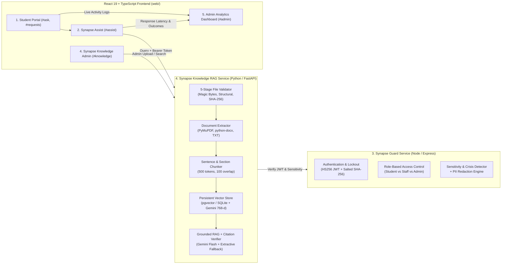

# Synapse: AI-Powered University Student Services Platform
## Comprehensive Source Document for NotebookLM & Presentation Generation

---

## 1. Executive Summary & Project Vision

**Synapse** is a modern, safety-first university student services portal and AI knowledge platform developed by Group 3 (205 Project). Universities face a recurring operational challenge: students struggle to find accurate answers across dozens of scattered policy PDFs, handbooks, and departmental web pages, while student support staff are overwhelmed by repetitive routine enquiries on enrollment, tuition fees, timetables, exams, and IT support. At the same time, deploying raw generative AI chatbots in a university setting carries severe risks: hallucinated academic policies, fabricated deadlines, privacy leaks, and inappropriate automated responses to students in crisis.

**Synapse solves both problems through a five-module architecture:**
1. **Synapse Student Portal & Workspace (`#/ask`, Topic Pages, `#/requests`)**: A calm, accessible student portal with instant FAQ search, structured step-by-step service guides, and end-to-end staff request tracking.
2. **Synapse Assist (`#/assist`)**: A student-facing conversational AI assistant that answers routine academic and administrative questions strictly from approved university documents, with inline numbered citations (`[S1]`) and expandable source excerpts.
3. **Synapse Guard (`guard/` & `/api/auth`, `/api/guard`)**: The security, authentication, role-based access control (RBAC), personal-data (PII) redaction, and sensitive-enquiry escalation layer that sits in front of the AI.
4. **Synapse Knowledge (`#/knowledge` & `/api/knowledge`)**: A complete document intelligence and Retrieval-Augmented Generation (RAG) engine where administrators upload official PDF, DOCX, and TXT policies, extract and chunk text with page and section metadata, index semantic embeddings (`gemini-embedding-001`), and verify answers in a search playground.
5. **Synapse Admin Dashboard (`#/admin`)**: A real-time operational analytics dashboard giving university staff visibility into question volume, answer rates, response latency, topic demand, student helpfulness ratings, and escalated staff requests.

---

## 2. Core Problem Statement

| Challenge in Traditional University Support | How Synapse Solves It |
|---|---|
| **Scattered Information:** Policies live across long PDFs, Word handbooks, and web pages. | **Synapse Knowledge** ingests PDF, DOCX, and TXT documents into a single semantic vector index with page and section tracking. |
| **AI Hallucinations:** Generic LLMs invent deadlines, fee waivers, or rules. | **Strict Source-Grounded RAG:** Answers are generated *only* from retrieved passages above a cosine similarity threshold (`0.62`), with post-generation citation validation and lexical grounding checks. |
| **Sensitive & Crisis Enquiries:** AI should never improvise advice on mental health crises, harassment, academic appeals, financial hardship, or visa/legal issues. | **Synapse Guard** intercepts sensitive topics *before* any LLM call and routes the student directly to human staff (displaying emergency helpline `999` for urgent wellbeing cases). |
| **Student Privacy (PII):** Students frequently paste Student IDs, phone numbers, Emirates IDs, emails, or card numbers into chat boxes. | **Automatic PII Masking:** Guard redacts personal identifiers (`[STUDENT_ID]`, `[EMAIL]`, `[PHONE]`, `[EMIRATES_ID]`, `[CARD_NUMBER]`) before logging or sending queries to external AI APIs. |
| **Staff Blind Spots:** Support teams lack visibility into what students are asking and where documentation gaps exist. | **Synapse Admin Dashboard** tracks live query volume, answered vs. escalated vs. unanswered rates, average latency (`ms`), student ratings, and open requests. |

---

## 3. Complete Five-Module System Architecture

---

## 4. Deep-Dive by Module

### Module 1: Synapse Student Portal & Request Management (`web/`)
- **Overview & Quick Search (`#/ask`)**: Provides an approachable search bar, topic filters, and a visual support network map. Students can rate answers (`Helpful` / `Not helpful`) to feed quality metrics.
- **Structured Topic Guides**: Dedicated pages for **Enrollment** (`#enrollment`), **Policies** (`#policies`), **Timetables** (`#timetables`), **Exams** (`#exams`), **Fees & Payments** (`#fees`), **IT Support** (`#it`), and **Support Services** (`#support`), each presenting at-a-glance facts, step-by-step checklists, and academic timelines.
- **Staff Request Tracking (`#/requests`)**: When an enquiry is escalated or a student clicks *"Speak to a person"*, their question and chat transcript are packaged into a tracked request with a 3-stage visual stepper (`Waiting for staff` → `In progress` → `Resolved`).
- **Accessibility by Design**: Built with keyboard navigation, `aria-live` announcements, high-contrast university colour palette (`#12353a` navy, `#1e615e` teal brand, warm paper canvas), minimum 44px touch targets, and `prefers-reduced-motion` support.

### Module 2: Synapse Assist — Grounded Conversational AI (`#/assist`)
- **Safety-First Execution Order**:
  1. Checks sensitivity locally and server-side via **Synapse Guard**. Sensitive enquiries immediately trigger a warm human-handoff card instead of calling the AI.
  2. Queries **Synapse Knowledge** (`POST /api/knowledge/query`) for semantic retrieval and grounded answer generation over indexed university documents.
  3. Renders inline numbered superscript badges (`[1]`, `[2]`) mapped to expandable citation drawers showing **Document Name**, **Page Number**, **Section Heading Path**, and the **Verbatim Supporting Excerpt**.
  4. **Graceful Degradation**: If the knowledge backend or LLM is unreachable, Assist falls back seamlessly to verified extractive passages and built-in approved FAQs so students are never left with a broken interface.
- **Conversation History**: Supports multi-turn context (carrying forward recent questions for short follow-ups like *"and extensions?"*), searchable local conversation history, and one-click transcript attachment when escalating to staff.

### Module 3: Synapse Guard — Security, RBAC & Sensitivity Engine (`guard/`)
- **Authentication & Brute-Force Protection**:
  - Issues signed HS256 JWT tokens (`2h` expiry) with `bcrypt` / salted SHA-256 credential verification.
  - Enforces account lockout after 5 failed sign-in attempts and returns generic error messages to prevent account enumeration.
- **Role-Based Access Control (RBAC)**:
  - Central permission map separating **Student** (`chat:use`, `history:read:own`) from **Admin** (`dashboard:view`, `escalations:manage`, `knowledge:upload`, `audit:view`, `users:manage`).
  - Enforced server-side on every FastAPI and Express endpoint (`401 Unauthorized` for missing/expired tokens; `403 Forbidden` when a student attempts any administrative action).
- **7-Category Sensitivity & Crisis Classifier**:
  - Automatically detects and escalates:
    1. **Mental Health & Crisis** (`critical` risk — displays emergency number `999` immediately)
    2. **Harassment & Personal Safety** (`critical` risk)
    3. **Academic Integrity & Discipline** (`high` risk — plagiarism, misconduct, appeals)
    4. **Grades & Personal Academic Records** (`high` risk — GPA/grade disputes)
    5. **Visa & Immigration** (`high` risk)
    6. **Financial Hardship & Refunds** (`high` risk)
    7. **Formal Complaints** (`medium` risk)
- **Personal Data (PII) Redaction**:
  - Automatically masks emails (`[EMAIL]`), UAE Emirates IDs (`[EMIRATES_ID]`), payment card numbers (`[CARD_NUMBER]`), phone numbers (`[PHONE]`), and 7–8 digit student IDs (`[STUDENT_ID]`) before text is logged or sent to an external AI model.

### Module 4: Synapse Knowledge — Document Intelligence & RAG (`knowledge/`)
- **5-Stage Upload Validation (`validation.py`)**:
  - Sanitises filenames (stripping path traversal and control characters).
  - Enforces `.pdf`, `.docx`, `.txt` whitelist and 20 MB size limit.
  - Verifies true file type via magic bytes (`%PDF-`, ZIP structure containing `word/document.xml`, or UTF-8/CP1252 printable text) — defeating extension spoofing (such as an `.exe` renamed to `.pdf`).
  - Verifies structural integrity by opening the stream in PyMuPDF / `python-docx` to reject corrupted or encrypted files (`422`).
  - Computes SHA-256 content checksums to reject duplicate uploads (`409 Conflict`).
- **Structure-Preserving Extraction (`extraction.py`)**:
  - **PDF (PyMuPDF):** Analyses span font sizes and bold flags against median body text to infer section hierarchy (`1. Purpose › 3.2 Late submission penalties`), removes repeated running headers/footers, and records 1-based page numbers on every block.
  - **DOCX (`python-docx`):** Preserves `Heading 1–6` hierarchy and converts tables into pipe-delimited rows so fee schedules and deadlines remain intact.
  - **TXT:** Normalises encodings (`UTF-8-SIG`, `UTF-16`, `CP1252`) and extracts Markdown/uppercase headings.
- **Intelligent Sentence-Aware Chunking (`chunking.py`)**:
  - Configurable target size (`500` tokens) and overlap (`100` tokens).
  - Never splits sentences mid-way; flushes clean boundaries on section transitions and tracks exact page ranges (`page_number` to `page_end`) on every chunk.
- **Embedding Abstraction & Persistent Vector Store (`embeddings.py`, `vectorstore.py`)**:
  - Supports **Google Gemini** (`gemini-embedding-001`, 768 dimensions, L2-normalised, with asymmetric `RETRIEVAL_DOCUMENT` and `RETRIEVAL_QUERY` task types), **OpenAI** (`text-embedding-3-small`), and **Local ONNX** (`fastembed`).
  - Persists vectors in **PostgreSQL + `pgvector`** (HNSW index) or **SQLite float32 BLOBs** (exact NumPy cosine search).
  - Stores an embedding model signature in `kb_settings` so model changes are detected and cannot silently corrupt search results.
- **Anti-Hallucination & Prompt-Injection Defence (`rag.py`)**:
  - Escapes retrieved chunks inside `<source id="S1" ...>` XML tags and instructs the LLM to treat all document content as untrusted data.
  - Detects and warns on prompt-injection patterns inside uploaded documents (e.g., *"ignore previous instructions"*).
  - Strips any citation marker not present in the retrieved set, requires a lexical support ratio `>= 0.50` against cited passages, and abstains (`insufficient_evidence`) when no passage clears the similarity threshold.
- **Administrator Portal (`#/knowledge`)**:
  - Live overview metrics, drag-and-drop multi-file uploader with byte-level progress bars, searchable document library, processing job history & chunk inspector modal, and a **Knowledge Search Playground** to test retrieval scores and grounded answers before students use them.

### Module 5: Synapse Admin Dashboard (`#/admin`)
- **Live Operational Metrics**:
  - Tracks total **Questions**, **Answered** count, **Need a person** (escalated sensitive queries), **Unanswered** count (documentation gaps), **Average response time** (`ms`), **Found it helpful** percentage, and **Staff requests resolved** rate.
- **Interactive Analytics**:
  - Filterable across **24 hours**, **7 days**, and **30 days** with an SVG activity trend chart (`ActivityChart.tsx`), topic breakdown bars, and a filterable recent-queries table linked to student staff-request statuses.
- **Cross-Tab Real-Time Sync**:
  - Listens to browser `storage` events and auto-refreshes so student enquiries submitted in one tab appear live on the administrator's dashboard.
- **Unified Admin Navigation (`AdminTopBar.tsx`)**:
  - Allows administrators signed into `#admin` to switch directly between **Dashboard** (`#admin`), **Synapse Knowledge** (`#knowledge`), and the **Student Portal** (`#ask`).

---

## 5. Testing, Verification & Deployment Summary

- **Automated Test Suites**:
  - **67 Backend Tests (`pytest`)**: 26 unit tests covering validation, PDF/DOCX/TXT extraction, and chunking + 40 API integration & security tests covering RBAC, JWT expiry, duplicate checksums, transactional cascade deletion, prompt-injection defence, Guard escalation/redaction, and rate limiting + 1 live end-to-end test against Google Gemini (`gemini-embedding-001` + Gemini Flash).
  - **8 Synapse Guard Tests (`node --test`)**: Verifies registration, login, 5-attempt lockout, RBAC middleware, PII masking, and sensitivity classification.
  - **Frontend Verification**: Zero TypeScript or `oxlint` errors; production bundle compiled with Vite 8.
- **Full-Stack Vercel Deployment**:
  - Unified under a single Vercel configuration (`vercel.json`) combining the static React build (`web/dist`), the Node/Express Guard serverless API (`/api/auth/*`, `/api/guard/*`), and the Python/FastAPI Knowledge ASGI serverless API (`/api/knowledge/*`), with automatic cold-start seeding of three sample university documents (`Academic Regulations 2026.pdf`, `Student Handbook 2026.docx`, `IT Help Desk FAQ.txt`).

---

## 6. Ready-to-Use Prompts for NotebookLM & Slide Deck Generation

### Prompt 1: For NotebookLM (Generate a Slide-by-Slide Presentation Outline & Speaker Notes)
> **Copy and paste this into NotebookLM after uploading this document:**
>
> "Using the uploaded Synapse source document, create a complete 10-slide executive and technical presentation deck for our university panel review. For every slide, provide:
> 1. **Slide Title & Visual Layout Suggestion** (e.g., diagram, comparison table, 3-column cards, live demo flow)
> 2. **3–4 Concise Bullet Points** (maximum 12 words per bullet, high impact, no fluff)
> 3. **60-Second Presenter Speaker Notes** written in a confident, clear engineering voice.
>
> Structure the 10 slides as follows:
> - **Slide 1:** Title & Vision — Synapse: Safe, Source-Grounded AI for University Student Services
> - **Slide 2:** The Problem — Scattered University Policies, Staff Overload, and AI Hallucination Risks
> - **Slide 3:** The 5-Module Synapse Architecture (Student Portal, Assist, Guard, Knowledge, Admin Dashboard)
> - **Slide 4:** Synapse Guard — Authentication, RBAC, PII Masking & Sensitive Crisis Escalation
> - **Slide 5:** Synapse Knowledge — 5-Stage File Validation, Structure-Preserving Extraction & Smart Chunking
> - **Slide 6:** Semantic Vector Retrieval & Anti-Hallucination RAG Pipeline (`gemini-embedding-001` + Citation Verification)
> - **Slide 7:** Student Experience — Synapse Portal & Synapse Assist with Verifiable Page/Section Citations
> - **Slide 8:** Administrator Experience — Knowledge Management Playground & Live Operational Analytics Dashboard
> - **Slide 9:** Security, Prompt-Injection Defence & Testing (67 Backend Tests + 8 Guard Tests + Live Gemini Verification)
> - **Slide 10:** Live Deployment Architecture, Key Takeaways & Future Roadmap"

### Prompt 2: For Gamma / Canva / Marp / PowerPoint Copilot (Direct Deck Generation)
> **Copy and paste this into Gamma.app or PowerPoint Copilot along with this document:**
>
> "Create a polished, modern 10-slide university software architecture presentation titled **'Synapse: Safe, Source-Grounded AI & Document Intelligence for Student Services'**. Use a clean academic theme (deep teal `#1e615e`, navy `#12353a`, warm cream background, gold accents). Emphasize how our 5 integrated modules—Student Portal, Synapse Assist, Synapse Guard, Synapse Knowledge (RAG), and Admin Dashboard—prevent AI hallucinations through strict semantic retrieval (`gemini-embedding-001`), verifiable page-level citations, automatic PII redaction, and mandatory human escalation for sensitive wellbeing, financial, and academic appeal enquiries. Include architecture flowcharts, before-vs-after tables, security highlights, and our 75 passing automated tests."
